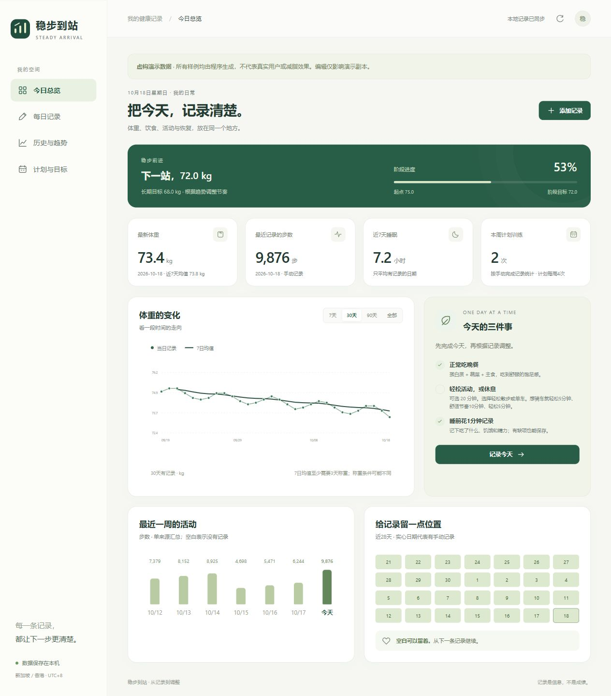

# 稳步到站 · Steady Arrival

一个本地优先的全栈健康记录应用，把每日记录、Apple 健康历史数据、训练计划和趋势图放在同一个地方，并通过公开展示页见证长期改变。

“薄肌理论”倡导：自我提升、长期主义和向内探寻。从改变身体开始，感受努力带来的回报，重新发现内在秩序，重获对生活的掌控。

[理念与俱乐部海报](docs/lean-club.md) · [公开成长记录（启用 Pages 后）](https://littlecrawler.github.io/Steady-Arrival/)

项目包含浏览器前端、Node.js REST API、持久化数据层、Apple Health XML 流式导入器和自动化测试。无需购买服务、注册账户或安装第三方运行依赖。

下图使用明确标注的虚构演示数据：

## 直接使用

需要 Node.js 20.19+（推荐 24）。导入 Apple 健康时另需 Python 3.9+。

Windows 双击 **Start-App.cmd**，程序会打开本机页面。双击 **Stop-App.cmd** 可停止通过启动器启动的服务；数据不会删除。

其他系统，或从终端运行：

    npm start

打开 http://127.0.0.1:8765 。第一次运行自动建立空白记录库；在「计划与目标」修改个人设置。默认设置是占位值。

日常使用：

1. 在「每日记录」填写当日体重、饮食、活动、睡眠与感受，允许留空。
2. 在「历史与趋势」选择指标、时间范围，搜索或编辑已有日期。
3. 在「计划与目标」查看训练动作、修改阶段目标、导出备份。

## 功能

- 今日总览、阶段进度、体重曲线、最近一周活动。
- 体重、腰围、设备体脂、步数、饮食、摄入估算、蛋白质、睡眠、饥饿、精力、压力与训练记录。
- 体重图只显示一条实际记录曲线，同日手动值优先，不叠加均线；缺测不补零。统计卡中的7日均值至少需要3天有记录。
- Apple 健康历史导入，按 UTC+8 日历日汇总并保留来源。
- 内置热量收支计算器：每餐估算范围、全天消耗和差额；缺项、旧估算及导出当天不完整的设备消耗会明确标出。[计算方法与来源](docs/calorie-estimates.md)。
- 历史表格分页、日期和文字筛选、CSV 导出。
- 手动 JSON 备份与恢复；重合日期可保留现有数据或用备份替换。
- 服务器校验、修订号冲突检测、原子替换与上一版文件副本。
- 适配桌面与手机屏幕；本机地址只支持本机访问。

## 导入 Apple 健康

从 Apple 健康导出所有健康数据，解压，把主要的健康 XML 放到项目的 imports 文件夹中。不要选择 export_cda.xml。

执行：

    npm run import:health

或在网页「计划与目标」点击「重新读取本地 Apple 健康 XML」。

也可明确指定文件：

    python scripts/import_apple_health.py "imports/apple_health_export/export.xml"

自动查找时兼容 imports 和原有的「导出」文件夹；存在多个 XML 时，选择体积最大的文件。更新导出前请移走旧文件，或者使用显式文件路径。导入器生成 data/apple-health.json，保留手动记录。它导入的是文件快照，不是与手机的实时连接。

### 汇总规则与限制

| 数据 | 处理方法 |
| --- | --- |
| 体重、体脂等测量 | 同一天保留最后一次样本；手动值优先展示，导入原值保留 |
| 步数、活动热量等累计量 | 去掉完全相同的重复样本；同一天同一指标选择合计最大的单一来源，不把手机和手表相加 |
| 跨午夜累计量 | 根据时段与 UTC+8 日历日的重叠比例拆分 |
| 睡眠 | 只把 Asleep 分类计为睡眠；InBed 单独显示为卧床 |
| 重叠睡眠时段 | 同一来源内取时间并集；多来源选择当天合计最长的来源 |
| 体脂百分比 | Apple 百分比单位的原始小数乘100，例如0.25显示25% |
| 设备运动 | 保留会话，按跨日时段的并集统计；可能包含暂停，不自动勾选计划训练完成 |
| 摄入与消耗 | 可能来自不完整记录或设备模型，均标明为估算，不据此宣称确定缺口 |

导出的 XML 不包含足以完整复现健康 App 来源优先级的全部信息，因此汇总值可能与健康 App 不完全相同。目前只导入列明的指标和单位；不支持的指标留在原 XML，不会误填成零。

## 数据与隐私

本项目发起人已明确选择将真实健康指标、饮食与训练打卡公开，用于监督自己的长期执行。仓库中的 `public/progress.json` 是经过字段筛选的真实数据快照。

| 路径 | 用途 | 是否进入 Git |
| --- | --- | --- |
| data/tracker.json | 手动记录、个人设置 | 否 |
| data/apple-health.json | 健康导出的每日汇总与运动会话 | 否 |
| data/*.previous.json | 最近一次替换前的副本 | 否 |
| imports/、导出/、XML、ZIP | 原始健康导出 | 否 |
| .runtime/ | 本地日志与演示副本 | 否 |
| public/progress.json | 本人主动公开的真实健康指标、饮食与训练记录 | 是 |
| dist/assets/ | AI 生成的薄肌俱乐部海报（简体与繁体） | 是 |
| dist/、scripts/、tests/ | 程序与使用虚构数据的测试 | 是 |

本地页面的图表提示、历史表格及 CSV 中，设备来源统一显示为“Apple 健康导入”；手动记录和对话记录分别标明。原始设备来源仅保留在本地健康汇总和完整备份中。

公开快照包含每天的可用健康指标、个人阶段目标、饮食文字、当前每餐热量估算与份量假设、训练状态及动作感受；手动记录与设备来源分别保留。一般备注、个人背景说明、设备个人名称、设备 ID、运动轨迹和原始导出不进入公开快照。发布范围由 `scripts/export-public.mjs` 明确列出。饮食与训练备注请只填写愿意公开的内容。完整本地备份仍由本人保管。

当前服务绑定127.0.0.1，校验 Host 与 Origin，无外部统计、字体或脚本请求。它面向单用户本机运行，没有账户系统和互联网部署所需的认证。GitHub 同步代码并不等于上线网站，也不适合直接把数据接口暴露到公网。

## 公开监督与日常同步

公开页使用同一套界面，展示真实指标趋势、每天的饮食训练详情、行动计划、薄肌理论及两版海报。访客只能查看，无法修改本地记录。页面明确标注快照更新时间、设备导出时间和数据缺失。

日常先在本地应用保存记录，再双击 **Sync-GitHub.cmd**：它整理公开字段，只提交 `public/progress.json`，然后推送到本仓库的 main 分支。GitHub Actions 随后更新公开网站；它不是手机或本地应用的实时同步。运行同步需要本机已经配置好 GitHub SSH 访问。遇到远端领先时会停止，请先处理同步，脚本不会强制覆盖。

手动整理与预览：

    npm run export:public
    npm run build:public
    python -m http.server 8767 --bind 127.0.0.1 --directory .runtime/public-site

打开 http://127.0.0.1:8767 。公开网站通过 `.github/workflows/pages.yml` 部署到 GitHub Pages；首次推送前，在仓库 **Settings → Pages → Source** 选择 **GitHub Actions**。如果先推送后开启，可在 **Actions → Publish public progress → Run workflow** 手动发布。[官方发布设置](https://docs.github.com/en/pages/getting-started-with-github-pages/configuring-a-publishing-source-for-your-github-pages-site)

完整的 Node.js 后端负责本地录入和保存；GitHub Pages 发布经过本人选择的只读快照。

## 手动提交与推送

在项目目录完成文件检查后，可自行提交和推送：

    git add .
    npm run check:privacy
    git commit -m "Update public progress, club vision and weight chart"
    git push -u origin main

后续只更新每日公开记录时，可双击 Sync-GitHub.cmd。首次网站发布前开启仓库 Pages 的 GitHub Actions 来源。

## 技术结构

    dist/
      index.html      应用外壳
      styles.css      响应式界面
      app.js          页面、表单与图表
      domain.js       校验、统计、计划、CSV
      charts.js       单条实际数据曲线、日期去重和缺测处理
    server.mjs        本机 HTTP 服务与 REST API
    scripts/
      setup.mjs       仅在缺失时创建空白数据
      import_apple_health.py
      demo.mjs        独立虚构演示
      check-private-files.mjs
    tests/            领域逻辑、API、导入器测试

数据流：浏览器 → REST API → 校验与修订号检查 → 本地 JSON 持久化。导入器以流式方式读取大 XML，生成独立汇总；浏览器按日期合并展示。

选用 JSON 文件存储便于单用户检查和备份。服务实例内串行写入；多个服务实例不能同时写同一库。如果以后增加多用户、云端同步或大量并发写入，应迁移到事务数据库并加入认证。

### API

| 方法 | 路径 | 用途 |
| --- | --- | --- |
| GET | /api/health | 服务状态与当地日期 |
| GET | /api/state | 手动记录与设置 |
| PUT / DELETE | /api/records/YYYY-MM-DD | 保存或删除一日手动记录 |
| PUT | /api/profile | 更新个人设置 |
| GET | /api/health-data | Apple 健康汇总 |
| POST | /api/health/import | 重新导入本机 XML |
| GET | /api/export?format=csv | 导出合并后的每日表格 |
| GET | /api/export | 备份手动记录与设置 |
| POST | /api/import | 合并手动记录备份 |
| GET | /api/health-export | 备份 Apple 健康汇总 |

手动数据的写入请求带当前 revision。冲突返回409，前端保留输入。直接修改文件时应先停止服务，并另存备份；自动提醒只读取记录，不擅自填写执行结果。

## 演示与开发

    npm run demo

打开 http://127.0.0.1:8766 。演示记录全部由程序生成、明确标注为虚构，写在 .runtime/demo/ 中，与个人数据独立。重新启动演示会重建演示副本。

无需 npm install。运行检查：

    npm test
    npm run test:import
    npm run check:privacy

GitHub Actions 对 Windows 和 Linux 执行 Node 与 Python 测试。

## 健康信息边界

应用帮助记录和复盘，不诊断疾病，不根据 BMI 计算体脂，不保证减重速度。内置训练和饮食内容是可调整的初始安排；存在伤痛、疾病或持续不适时，需要专业评估。

参考：[HealthHub 体重管理](https://www.healthhub.sg/well-being-and-lifestyle/exercise-and-fitness/manage_weight_healthy_way)、[CDC 身体活动](https://www.cdc.gov/healthy-weight-growth/physical-activity/)、[Mayo Clinic 腿举](https://www.mayoclinic.org/healthy-lifestyle/fitness/multimedia/leg-press/vid-20084684)。

## 开发者的话

创作的动机是因为市面上的运动减脂App实在是太难用了，而且动辄要求各种会员，他难用的原因不是因为功能少或者怎么样，而是因为没办法个性化满足用户需要，所以创作这个项目的目的是为了开源以便用户可以在这个框架上自己开发自己想要的功能
