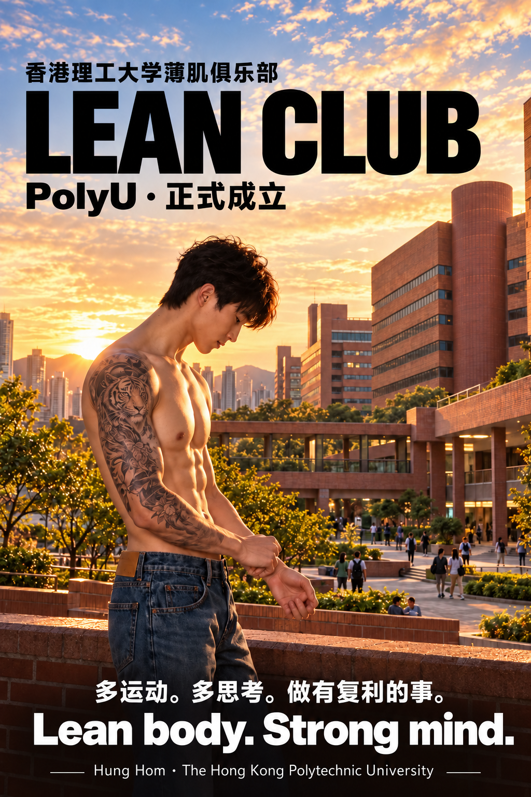

# 薄肌理论

> “薄肌理论”倡导：自我提升、长期主义和向内探寻。
>
> 从改变身体开始，感受努力带来的回报，重新发现内在秩序，重获对生活的掌控。

以上为项目发起人的原文。它是本项目的个人理念。

## 海报

[下载简体版](../dist/assets/lean-club-simplified.png) · [下载繁体版](../dist/assets/lean-club-traditional.png)

海报由 AI 生成，用于俱乐部形象表达；图中人物不是项目用户的身体变化照片。

多运动。多思考。做有复利的事。

Lean body. Strong mind.
